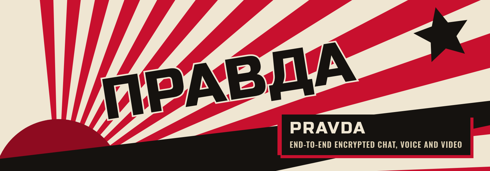
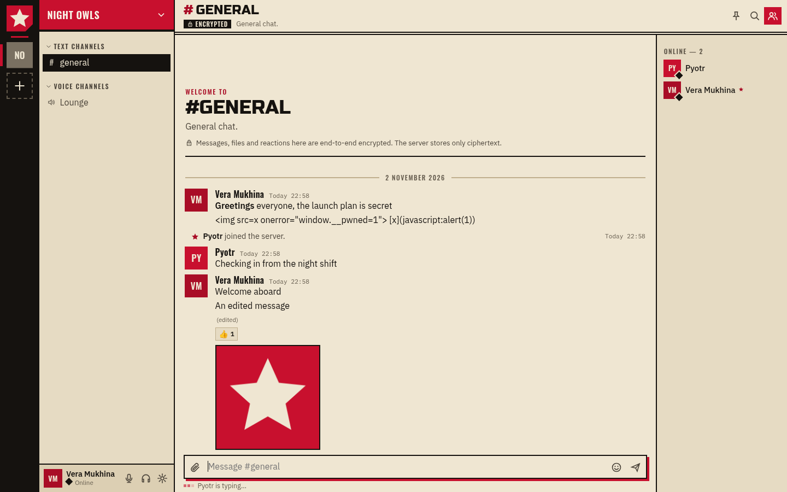
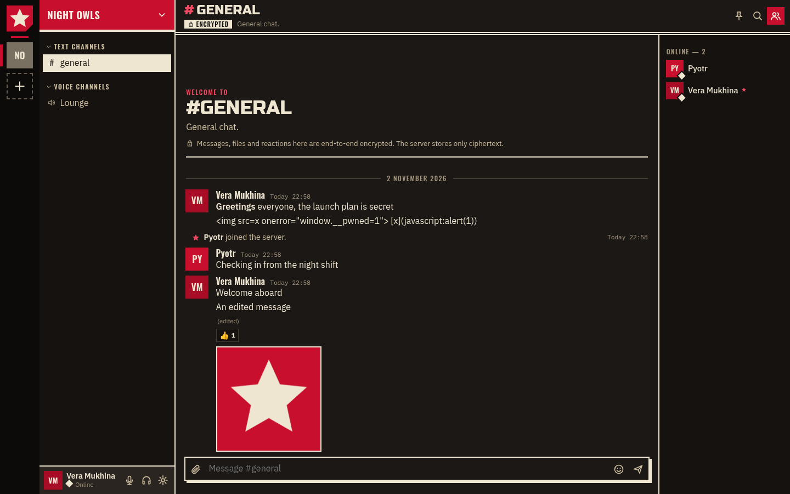
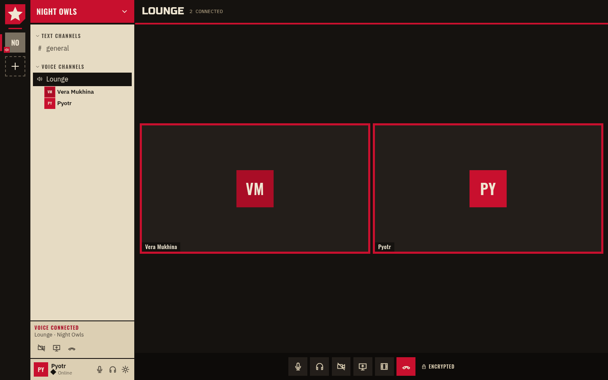
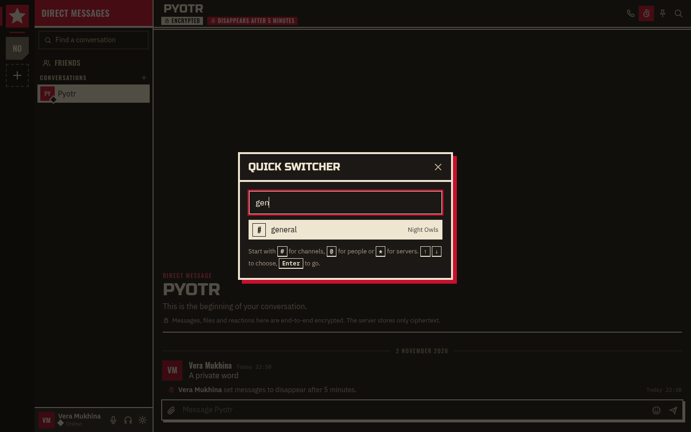
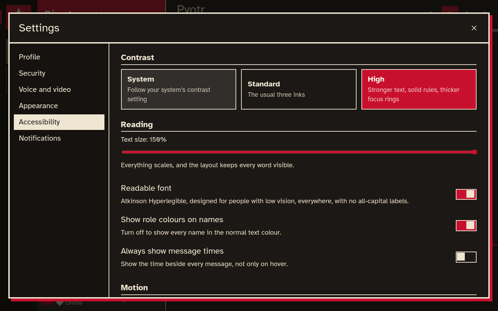

<p align="center">
  
</p>

<p align="center">
  
  
  
  
  <a href="https://github.com/DJagerStudios/pravda/actions/workflows/ci.yml"></a>
</p>

<p align="center">
  <b>A free, open source place for communities to talk, with everything end-to-end encrypted.</b><br>
  Servers with text and voice channels, direct messages, calls, video, screen sharing<br>
  and watching videos together, on a server you run yourself.
</p>

<p align="center">
  <a href="https://github.com/DJagerStudios/pravda/releases/latest"><b>Download the latest release</b></a>
  &nbsp;&middot;&nbsp; Windows, macOS and Linux, on x86 and ARM
</p>

<br>

<p align="center">
  
</p>

## Download

Get the files for your system from the [latest release](https://github.com/DJagerStudios/pravda/releases/latest):

- **Windows 10 / 11** (x64 and ARM64): a portable `.zip`. Extract it anywhere and run `Pravda.exe`.
- **macOS 13 (Ventura) or later**: a `.zip` with `Pravda.app` for Apple Silicon or for Intel.
- **Linux** (x86_64 and aarch64): an `.AppImage` for most distributions, a `.deb` for Debian and Ubuntu, or a `.tar.gz`.
- **The server on its own** (every system): `Pravda-server-<version>-<system>`, a single program with no dependencies.

Every release lists SHA-256 checksums in `Pravda-<version>-SHA256SUMS`. The builds are not signed by Apple or Microsoft: on macOS run `xattr -dr com.apple.quarantine /Applications/Pravda.app` once; on Windows choose "More info", then "Run anyway" in the SmartScreen prompt. The [release notes](https://github.com/DJagerStudios/pravda/releases/latest) have the install steps for each system.

**Updates install themselves.** When the desktop app starts, and every few hours after, it checks this repository's releases. It downloads a newer version, checks it against Pravda's signing key, and installs it. You can turn that off, or ask for beta versions, in Settings, Desktop app ([docs/updates.md](docs/updates.md)).

## Highlights

- **Everything end-to-end encrypted.** Messages, files, reactions, server, channel and role names, the server icon, and every frame of every call are encrypted on your device. The people running a server store only ciphertext.
- **Servers you run yourself.** One small program and one SQLite file. Host it on a home network with one click from the desktop app, or on the internet with an automatic HTTPS certificate.
- **Voice, video and screens.** Drop into a voice channel; share a camera or a screen with sound; push-to-talk or voice activity, with noise suppression and echo cancellation.
- **Watch together.** YouTube or a direct video link, in step for everyone, or a film from your own disk streamed into the call without uploading it.
- **Roles and permissions.** Two dozen permissions, ordered roles with colours, per-channel overrides for roles and single members, an audit log, kicks, bans, and muting or disconnecting people in calls.
- **Entry gates.** An invite link, optionally with a server password or a six-digit code that changes on a timer. The server's key travels in the link's `#fragment`, which never reaches the server.
- **Disappearing messages** on any channel or conversation, from 5 minutes to 30 days, deleted from every device and from the server.
- **An authenticator app is required** (Google Authenticator, Microsoft Authenticator, Aegis, 2FAS or any TOTP app), with recovery codes, a recovery key, your signed-in devices and safety numbers.
- **Quick to get around.** Ctrl+K jumps anywhere. Alt+↑/↓ moves between channels and Alt+Shift+↑/↓ goes to the next channel with something new. Escape marks a channel read, and a red rule shows where new messages begin.
- **Yours to tune.** Notification levels and muting per server, channel and conversation, per-person call volume and "mute for me", profiles with banners, colours and pronouns, and light and dark themes.
- **Made for everyone.** High contrast, a readable font for low vision, text up to 150%, full keyboard control, screen reader labels and announcements, reduced motion, and support for Windows high-contrast mode ([docs/ACCESSIBILITY.md](docs/ACCESSIBILITY.md)).

<p align="center">
  
  
</p>

## Encrypted, and honest about it

Pravda uses only standard browser cryptography: P-256 ECDH and ECDSA, AES-256-GCM, HKDF and PBKDF2. Your password never leaves your device. Channel keys come in generations and are sealed to each member; when someone loses access, the next message starts a generation they never receive.

End-to-end encryption hides content, not everything. A server still sees who is in which server, when messages are sent and how big they are, who is mentioned, and who is speaking in a call. [SECURITY.md](SECURITY.md) lists exactly what is protected, what is not, and the limits.

## Quick to use, for everyone

<p align="center">
  
  
</p>

Every action works from the keyboard; Ctrl+/ lists the shortcuts. Right-click a server, channel or conversation to mark it read, change its notifications or mute it. The Accessibility settings page has contrast, the readable font, text size, role colours, message times, motion and screen reader announcements.

## Run your own server

```sh
./pravda --tls-self-signed --listen 0.0.0.0:8347     # a home network
sudo ./pravda --domain chat.example.org             # the internet, with Let's Encrypt
```

The first account created runs the instance. [docs/HOSTING.md](docs/HOSTING.md) covers ports, firewalls, NAT, reverse proxies, backups and every option. The desktop app can also host a server on your computer with one click, showing the address and certificate fingerprint friends need.

## Build

You need [Go](https://go.dev/dl/) 1.27 or newer. The web client is plain JavaScript modules with no build step.

```sh
go build -o pravda ./cmd/pravda          # the server, with the web client built in
go test -race ./internal/...             # server tests
python3 -I packaging/build.py            # every desktop download and server archive, into dist/
```

The packaging script downloads Electron and the AppImage tools and checks them against pinned SHA-256 sums. It builds a portable `.zip` for Windows, `.zip` app bundles for macOS, an `.AppImage`, a `.deb` and a `.tar.gz` for Linux, and a standalone server for each system, all on x86 and ARM. It also writes the checksums and the signed update manifest. [CONTRIBUTING.md](CONTRIBUTING.md) covers development, the end-to-end tests and making a release.

## Documentation

- [SECURITY.md](SECURITY.md): the security model, what a server can still see, and how to report a vulnerability
- [docs/HOSTING.md](docs/HOSTING.md): running a server at home or on the internet
- [docs/DESKTOP.md](docs/DESKTOP.md): installing and using the desktop app
- [docs/updates.md](docs/updates.md): how updates are found, checked and installed
- [docs/ACCESSIBILITY.md](docs/ACCESSIBILITY.md): accessibility features and every keyboard shortcut
- [docs/PROTOCOL.md](docs/PROTOCOL.md): the API, the gateway and every encrypted format
- [docs/DESIGN.md](docs/DESIGN.md): what was learned from Discord, and the visual design
- [CHANGELOG.md](CHANGELOG.md): what changed in each version

## Architecture

| Area | Where | What it does |
|---|---|---|
| Server | `cmd/pravda`, `internal/server` | HTTP API, the realtime gateway, voice signalling and the security rules |
| Calls | `internal/sfu` | The selective forwarding unit, on Pion WebRTC; it forwards encrypted media it cannot read |
| Storage | `internal/store` | SQLite with versioned migrations |
| Permissions | `internal/perm` | Role and overwrite arithmetic, shared with the client |
| Web client | `web/public` | Preact and htm, no build step; served by the server and bundled by the desktop app |
| Encryption | `web/public/js/crypto.js`, `keys.js`, `e2ee-worker.js` | Keys, envelopes and per-frame media encryption |
| Desktop app | `desktop` | The Electron shell: keychain, tray, shortcuts, screen picker, hosting and updates |
| Packaging | `packaging/build.py`, `.github/workflows` | Every download, checksums, the signed update manifest and releases |
| Tests | `internal/**/*_test.go`, `e2e` | Server tests, two-browser end-to-end tests, and desktop and update tests in a private KWin session |

## How Pravda relates to Discord

Pravda offers the same kind of experience as Discord, and its structure was learned from Discord's public documentation and visible behaviour: servers, channels, roles, permission overwrites, a realtime gateway, voice channels. No Discord code was copied or decompiled. [docs/DESIGN.md](docs/DESIGN.md) has the details.

## Licence

Pravda is free software under the GNU Affero General Public License, version 3 or later ([LICENSE](LICENSE)). If you run a modified Pravda for others, you must offer them its source. Bundled fonts and libraries keep their own licences, listed in [LICENSES/](LICENSES).
