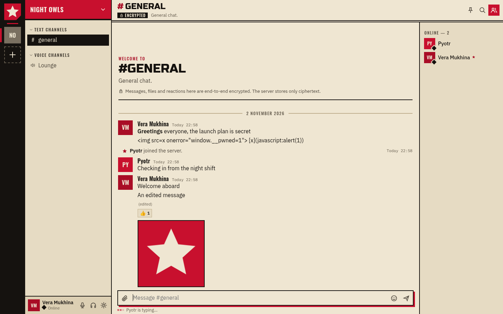
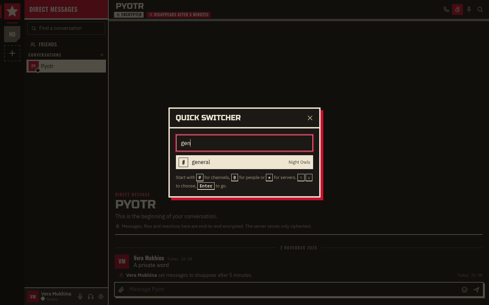
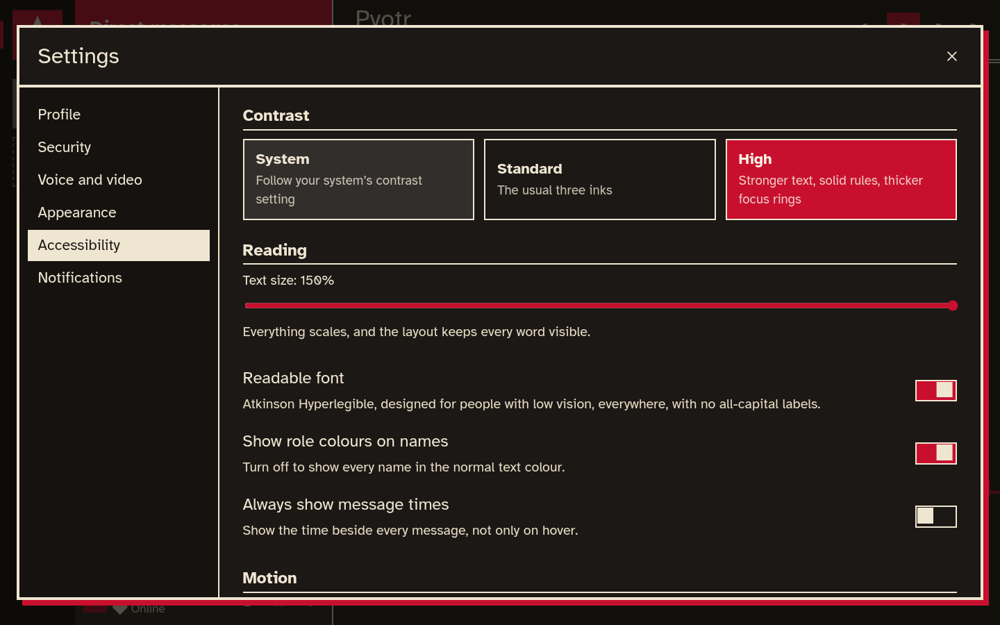

## Pravda 0.3.0: talk freely, on every desktop

Pravda 0.3.0 is the first public release. Pravda is a free, open source place for communities to talk: servers with text and voice channels, direct messages, calls, video, screen sharing and watching videos together. You run it yourself, and everything people write, share and say is end-to-end encrypted. This release brings desktop downloads for Windows, macOS and Linux on x86 and ARM that keep themselves up to date. It adds a keyboard-first way around, notification controls for every server, channel and conversation, and an accessibility settings page.

## Highlights

### Everything end-to-end encrypted

- **Content stays on your devices.** Messages, edits, files, reactions, server, channel and role names, the server icon and the choice of what to watch together are encrypted on your device. Every frame of every call is encrypted too, before it leaves. The server stores and forwards ciphertext.
- **Standard cryptography only.** P-256 ECDH and ECDSA, AES-256-GCM, HKDF and PBKDF2, all from the browser's own WebCrypto. Your password never leaves your device.
- **Keys that move on.** Channel keys come in generations, sealed to each member. When someone leaves or is removed, the next message starts a generation they never receive, and live calls switch keys at once.
- **Signed in twice.** An authenticator app is required by default, with recovery codes and a recovery key. Safety numbers let two people check nobody is in the middle.
- **Honest limits.** A server still sees who talks where and when, how big things are, who is mentioned and who is speaking. [SECURITY.md](https://github.com/DJagerStudios/pravda/blob/v0.3.0/SECURITY.md) says exactly what is and is not protected.

### Desktop downloads that update themselves

- **Every desktop.** Windows (x64 and ARM64), macOS (Apple Silicon and Intel) and Linux (x86_64 and aarch64), as a `.zip`, an `.AppImage`, a `.deb` or a `.tar.gz`. The app carries its own copy of the client, so a server cannot change the code that does your encryption.
- **Updated on launch.** When Pravda starts, it checks GitHub for a newer release. If there is one, it downloads it with progress on the opening animation, installs it and starts again as the new version. It checks again every six hours, and never restarts by itself while you are using it.
- **Checked before it is trusted.** Each release's manifest is signed with Pravda's Ed25519 release key, and every download must match the SHA-256 in that signed manifest. A tampered file or another key is refused.
- **Your choice.** Settings, Desktop app turns automatic installs off (Pravda then offers *Update*, *Later* or *Skip this version*) or opts into beta versions.
- **At home on your desktop.** Pravda remembers its window, can open at login and wait in the tray, shows unread mentions on the tray icon, the taskbar and the dock, and keeps running in the tray when the window closes. Ctrl+Shift+M and Ctrl+Shift+D mute and deafen from any app.

### Get around without the mouse

- **Quick switcher.** Ctrl+K, type a few letters, Enter. Start with `#` for channels, `@` for people or `*` for servers; channels with something new come first.
- **Channel to channel.** Alt+↑ and Alt+↓ move through a server's channels. Alt+Shift+↑ and Alt+Shift+↓ jump to the next channel with something new, across servers and conversations.
- **Where you left off.** A red *New* rule marks where unread begins. While it is out of view, a banner offers *Jump* and *Mark as read*. Escape marks a channel read, Shift+Escape a whole server.
- **Messages from the keyboard.** Once a message has focus, the arrow keys move between messages, Tab reaches its actions (react, reply, copy, edit, pin, delete) and Escape returns to the message box. Ctrl+/ lists every shortcut.

### Made for everyone

- **Contrast**: follow the system, or choose high contrast for full-strength text, solid rules and thicker focus rings.
- **Readable font**: Atkinson Hyperlegible, made by the Braille Institute for low vision, everywhere and in sentence case.
- **Text up to 150%**, with an automated check that nothing is clipped or overlaps at that size.
- **Screen readers** hear a name for every control, "3 mentions" for badges, unread and muted channels, and, if you like, each new message as it arrives.
- **Role colours** can be turned off, **message times** shown always, and **motion** reduced. Windows high-contrast mode is respected, and nothing relies on colour alone.

### Notifications your way

- **Per server, channel and conversation.** Right-click to choose all messages, only mentions, or nothing (muted). A channel follows its server unless you set its own level.
- **Muted means quiet.** Muted channels recede, show no unread marker and send no alerts; mentions are still counted.
- **Mute for me.** Silence one person in a call without anyone else knowing, alongside their volume slider.

## And more

- *Mark as read* for servers and channels, and *Copy text* on every message.
- One cream, red and black palette for light and dark themes. The interface is in plain English; the poster style is for the graphics.
- The opening animation is a turning sunburst behind a red sun and a black star, and it shows update progress.
- Skip links, menus driven by the arrow keys, and focus that returns where it was when a dialog or menu closes.
- The Linux packages add Pravda to your application menu; the `.tar.gz` has an `install.sh` for the same.
- Hosting from the desktop app shows the addresses and the certificate fingerprint friends need, and the firewall ports to open.

## Fixed

- The opening animation could stay up forever when the server answered very quickly, or in a window that received no animation frames.
- On Wayland, desktop windows could wait forever for their first frame and never appear.
- The YouTube player in a watch party kept seeking when it never reported its position.

## Upgrading

- This is the first published release, so there is nothing to upgrade from. From now on, the desktop app updates itself.
- Servers: run the new `pravda` in place of the old one. The database migrates itself on start. Browsers pick up the new client on their next reload.

## Install

| System | File |
|---|---|
| Windows 10 / 11, x64 | `Pravda-0.3.0-windows-x64.zip` |
| Windows 10 / 11, ARM64 | `Pravda-0.3.0-windows-arm64.zip` |
| macOS 13 or later, Apple Silicon | `Pravda-0.3.0-macos-arm64.zip` |
| macOS 13 or later, Intel | `Pravda-0.3.0-macos-x64.zip` |
| Linux x86_64 | `.AppImage`, `-linux-amd64.deb` or `-linux-x86_64.tar.gz` |
| Linux aarch64 | `.AppImage`, `-linux-arm64.deb` or `-linux-aarch64.tar.gz` |
| The server on its own | `Pravda-server-0.3.0-<system>`, for every system above |

- **Windows**: extract the `.zip` anywhere and run `Pravda.exe`. The build is not code-signed: if SmartScreen appears, choose "More info", then "Run anyway".
- **macOS**: unzip, move `Pravda.app` to Applications, then run once in Terminal: `xattr -dr com.apple.quarantine /Applications/Pravda.app`. The build is not notarised by Apple.
- **Linux**: `chmod +x Pravda-0.3.0-linux-x86_64.AppImage` and run it; or `sudo apt install ./Pravda-0.3.0-linux-amd64.deb`; or extract the `.tar.gz`, run `./pravda`, and `./install.sh` to add it to your application menu.
- **Server**: extract and run `./pravda --tls-self-signed --listen 0.0.0.0:8347` for a home network, or `--domain chat.example.org` for the internet. [docs/HOSTING.md](https://github.com/DJagerStudios/pravda/blob/v0.3.0/docs/HOSTING.md) has the details.

The desktop app updates itself from the AppImage, the `.tar.gz`, the Windows `.zip` and the macOS app. A `.deb` install is updated by downloading the new `.deb`; Pravda shows a link when one is out.

## Checksums

Every file's SHA-256 checksum is in `Pravda-0.3.0-SHA256SUMS`. Check a download with `sha256sum -c Pravda-0.3.0-SHA256SUMS --ignore-missing` (Linux), `shasum -a 256 -c Pravda-0.3.0-SHA256SUMS --ignore-missing` (macOS) or `Get-FileHash <file>` (Windows PowerShell).

`Pravda-0.3.0-update.json` and `Pravda-0.3.0-update.json.sig` are what the desktop app's updater reads. The manifest lists every download's size and SHA-256 and is signed with Pravda's release key. Its public half is [`desktop/release-key.pem`](https://github.com/DJagerStudios/pravda/blob/v0.3.0/desktop/release-key.pem).
